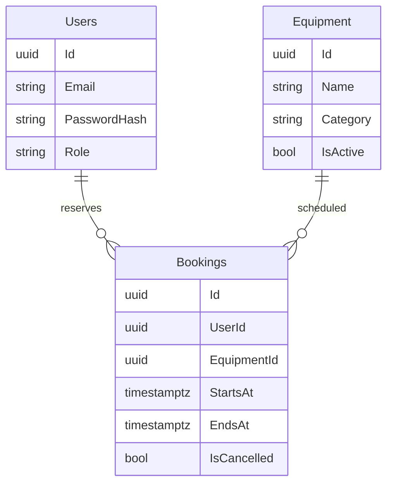

# Equip — бронирование оборудования

Pet-проект для портфолио .NET backend-разработчика. Два соседних проекта:

```text
RiderProjects/
├── EquipmentBooking/       ASP.NET Core API, БД, тесты
└── EquipmentBooking.Web/   React + TypeScript + Vite
```

## Возможности

- Регистрация, вход и выход; роли Member / Admin.
- Каталог, категории, поиск на фронтенде; добавление и обслуживание оборудования администратором.
- Публичное расписание занятых интервалов без персональных данных.
- Бронирование на срок до 24 часов, максимум на 90 дней вперёд.
- Личный список бронирований; администратор видит все. Отмена освобождает интервал.
- Пароли хешируются ASP.NET Core PasswordHasher. Сессия в HttpOnly cookie; изменения защищены CSRF-токеном. Вход и регистрация ограничены по частоте.

## Быстрый запуск без Docker (демо)

Установлены .NET SDK 8 и Node.js 22. В двух терминалах PowerShell:

```powershell
cd C:\Users\maxim\RiderProjects\EquipmentBooking
dotnet run --project src/EquipmentBooking.Api --launch-profile Demo
```

```powershell
cd C:\Users\maxim\RiderProjects\EquipmentBooking.Web
npm install
npm run dev
```

Открыть http://localhost:5173, зарегистрировать аккаунт. API: http://localhost:5080.
SQLite-файл создаётся автоматически. Демо предназначено для знакомства с интерфейсом; проверять конкурентные записи следует на PostgreSQL.

Чтобы создать администратора, перед первым запуском API задайте:

```powershell
$env:Seed__AdminEmail = 'admin@equipment.local'
$env:Seed__AdminPassword = 'Your-local-password-123!'
```

Пароль не хранится в исходниках. Seed создаёт администратора один раз и не меняет пароль существующего аккаунта. Зарегистрированному через форму пользователю роль Admin не присваивается.

## Основной запуск: PostgreSQL + API в Docker

Запустите Docker Desktop, затем:

```powershell
cd C:\Users\maxim\RiderProjects\EquipmentBooking
Copy-Item .env.example .env
# Откройте .env и задайте собственные ADMIN_PASSWORD и POSTGRES_PASSWORD.
docker compose up --build -d
```

Фронтенд запускается отдельно командой `npm run dev` в соседней папке. Swagger: http://localhost:5080/swagger. Через Swagger можно читать API; для изменений нужны cookie и CSRF header (см. API ниже).

Для API из Rider: `docker compose up -d db`, затем профиль `http` в Rider или `dotnet run --project src/EquipmentBooking.Api --launch-profile http`. Если изменили пароль БД в `.env`, задайте соответствующий `ConnectionStrings__Database` для локального API.

Остановка: `docker compose down`. Данные сохраняются в volume. Миграция применяется при запуске API. `EnsureCreated` используется только в SQLite demo/tests.

## Архитектура и важное решение

ASP.NET Core Controllers → Application services → EF Core Infrastructure → PostgreSQL. Solution разделён на четыре проекта: Domain, Application, Infrastructure и Api. Контроллеры обрабатывают HTTP; бизнес-сценарии, сущности, DTO, настройки и работа с БД находятся в отдельных слоях и файлах. Program.cs служит только точкой сборки приложения.

Подробности: [архитектура и структура проекта](docs/architecture.md).

Интервалы полуоткрытые `[начало, конец)`: бронь 10:00–11:00 не конфликтует с 11:00–12:00. API принимает ISO 8601 с часовым смещением, сохраняет UTC, React показывает местное время.

Обычной проверки `AnyAsync` недостаточно: два запроса могут одновременно увидеть свободный слот. Поэтому PostgreSQL-миграция создаёт `EXCLUDE USING gist` для пары equipment + `tstzrange`, только для неотменённых записей. База разрешит одну вставку, вторую отклонит; API преобразует SQLSTATE 23P01 в HTTP 409. Ограничение действует между несколькими экземплярами API. Расширение `btree_gist` создаётся миграцией; пользователь БД должен иметь право его установить.



`src/EquipmentBooking.Infrastructure/Persistence/Migrations/Initial.cs` содержит начальную SQL-миграцию PostgreSQL. Последующие изменения схемы оформляются отдельными миграциями; SQL-ограничение пересечений должно сохраняться. Добавлены model snapshot, designer и локальный dotnet-ef; команды сопровождения миграций описаны в docs/architecture.md.

## Проверка

```powershell
dotnet test
cd ..\EquipmentBooking.Web
npm test
npm run build
```

Backend: доменные правила, валидация и формат ProblemDetails, HTTP-сценарии на SQLite (cookie/CSRF, роли, пересечение, соседние интервалы, отмена, чужие записи, обслуживание). Отдельный PostgreSQL-тест отправляет два конкурентных запроса. Локально он пропускается без `TEST_POSTGRES`; GitHub Actions запускает его с сервисом PostgreSQL.

Для запуска PostgreSQL-теста локально используйте **отдельную тестовую БД** (тест добавляет оборудование и аккаунты):

```powershell
$env:TEST_POSTGRES = 'Host=localhost;Database=equipment_tests;Username=equipment;Password=your_password'
dotnet test
```

Frontend: CSRF и обработка ошибок API, форматирование интервалов. CI каждого проекта хранится в его `.github/workflows/ci.yml`; папки можно публиковать в отдельных репозиториях.

## API

| Метод | Путь | Доступ |
|---|---|---|
| GET | /health | Все |
| GET | /api/auth/csrf | Все; возвращает token и устанавливает CSRF cookie |
| POST | /api/auth/register, /api/auth/login | Все + CSRF |
| GET | /api/auth/me | Вход |
| POST | /api/auth/logout | Вход + CSRF |
| GET | /api/equipment | Все |
| GET | /api/equipment/{id}/schedule | Все |
| POST / PUT | /api/equipment, /api/equipment/{id} | Admin + CSRF |
| GET | /api/bookings | Свои / все для Admin |
| POST | /api/bookings | Вход + CSRF |
| POST | /api/bookings/{id}/cancel | Владелец / Admin + CSRF |

Для изменений получите `/api/auth/csrf`, сохраните cookie и передайте token в заголовке `X-CSRF-TOKEN`. После входа получите новый токен. Vite проксирует `/api` в API; CORS не нужен.

## Границы MVP

Нет email-подтверждения, сброса пароля, пагинации бронирований, уведомлений и полного UI редактирования оборудования (PUT API есть). SQLite не заменяет PostgreSQL при проверке конкурентности. Для внешнего размещения нужны HTTPS, общий origin/reverse proxy для React и API, постоянное хранилище ключей Data Protection и отдельный процесс миграции для нескольких экземпляров. Текущий Docker Compose рассчитан на локальную разработку.

Полезные следующие задачи для самостоятельной работы: пагинация с индексами, напоминания через BackgroundService, аудит действий администратора, нагрузочный тест конкурентных бронирований.
